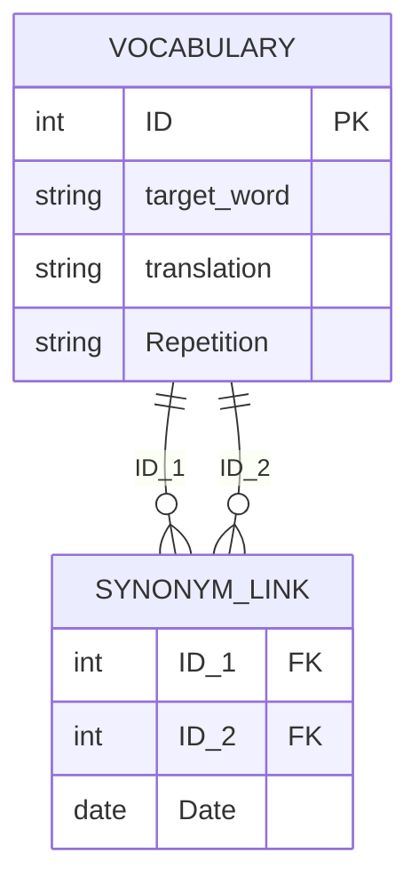

# Datové formáty a bezpečné ukládání

CSV používají oddělovač `;` a UTF-8. pandas umí uvozované hodnoty obsahující
oddělovač. Čtení zachovává doslovné texty NA/null a extra sloupce; loader
gramatiky a teorie podporuje BOM. Neplatný povinný obsah se nesmí automaticky
přepsat „opraveným“ souborem. Zdroj: [repositories](../../app/repositories).

## Slovní zásoba

`<Learned by>_<Language>_voc.csv`:

| Sloupec | Význam |
|---|---|
| ID | Trvalé celočíselné ID slovíčka; ostatní ID se při smazání neposunují. |
| Název studovaného jazyka | Zkoušené cizí slovo nebo fráze. |
| Phonetic | Výslovnost; u španělštiny tento sloupec není. |
| Název vlastního jazyka | Překlad. |
| Audio | Kanonická volba Automatic, Automatic - 11Labs, Own, No audio nebo konkrétní automatický provider. |
| Description, Example | Popis a příkladová věta; sentinel `-` znamená požadavek doplnění. |
| Part of Speech | Ručně vyplněný slovní druh. |
| Tags | Seznam stabilních ID katalogu oddělených čárkami, například `7, 12`. Prázdná hodnota je platná. Názvy jsou pouze prezentační. |
| Created | Datum vzniku, uchovávané při editaci. |
| Repetition | Historie S/F včetně počátečního učení. |
| Next repetition | Lokální datum a čas plánovaného opakování. |

Editor normalizuje mezery kolem štítků a odstraňuje prázdné položky i duplicity
bez ohledu na velikost písmen; zachovává první znění a pořadí. Čárka odděluje
štítky a není součástí názvu štítku. Filtr `equals` najde i jednotlivý celý
štítek uvnitř seznamu; `contains` a `excludes` zachovávají textové hledání.
Review word umožňuje přiřazení změnit; změna se ukládá spolu se session.
`encode_tags` přijímá názvy v obou katalogových jazycích i existující ID,
odmítá neznámé či nejednoznačné názvy a hlídá limit (výchozí 10).
`decode_tags` překládá ID pro editor, tabulku statistik a procvičování.

Historický Enabled se při práci vynechává; počítané Has synonyms a Synonym
count do CSV nepatří. Nové ID je max zbývajících ID + 1; mezery uvnitř se
nevyplňují. Extra sloupce zůstávají zachované.

## Katalogy štítků slovní zásoby

`<Learned by>_<Language>_tags.csv` je samostatný katalog pro jazykovou dvojici.
Původní `Czech_Spanish_tags.csv` a `Czech_English_tags.csv` byly naplněny 91 názvy
z dodaného seznamu; uživatelské katalogy se dále mění editací. Vazby ze slovníku
odkazují na jejich stabilní ID, nikoliv na pořadí řádků.

| Sloupec | Pravidla |
|---|---|
| ID | Jedinečné kladné celé číslo. Při odstranění položky se ostatní ID neposouvají. |
| Czech / název výchozího jazyka | Povinný jedinečný název bez ohledu na velikost písmen; standardní tvar Unicode NFC. |
| Spanish nebo English / název studovaného jazyka | Překlad štítku; může zůstat prázdný. |
| Note | Volitelná poznámka. |

Názvy nesmí obsahovat čárky ani nové řádky, protože `Tags` ve slovníkovém CSV
odděluje názvy čárkami. Překlady smějí být stejné u různých položek katalogu.
Neznámé další sloupce se uchovávají. Změna názvu nebo smazání položky katalogu
nemění ID přiřazená ve slovíčkách. Smazání používaného štítku není dovoleno.
Kontrola se provádí v dialogu i v repository pod zámkem datových souborů.
Při následném uložení slovníku
ale musí všechny neprázdné štítky patřit do katalogu: neznámý název odmítne
celou dávku s uvedením ID slovíčka. Oprava se provádí novým výběrem štítků
nebo doplněním katalogu. Žádné staré štítky se automaticky nemažou při načtení.
Vazby jsou stabilní ID katalogu. Názvy se mohou měnit bez změny vazeb.
Jednorázový převod existujících CSV ověřil všech 5 523 řádků a shodu všech
buněk mimo Tags. Neplatná přiřazení se při převodu vynechávají; v aktuálních
dvou slovnících žádná nebyla nalezena. Čtečky zůstávají kompatibilní i s názvy
ze starších CSV. Nové zápisy používají ID.
`validate_word_tags` v `vocabulary.tags_data` sjednotí velikost písmen podle
katalogového názvu. Kontrola probíhá před spuštěním ukládání i uvnitř
`save_workflow` před API/audio operacemi. Pokud se neprázdný použitý katalog
změní během přípravy uložení, kontrola jeho revize odmítne potvrzení transakce.

[Repository tags](../../app/repositories/tags.py) ověřuje strukturu, délku řádků,
ID a názvy před atomickým zápisem; při změně revize odmítne přepsání souboru.
Pouhé otevření chybějícího katalogu soubor nezakládá, až výslovné Save.
Obecný `backup_files` katalogy automaticky zahrnuje pouze pokud obsahují řádky.

## Gramatika a teorie

`<Language>_gra.csv`: question_id, category (kompatibilně Category), prompt,
anchor, option_1 až option_4, explanation, R, LR. Prompt je instrukce, anchor
zadání/věta. Správná odpověď je v CSV vždy option_1; při zobrazení se možnosti
zamíchají. R je historie, LR poslední zapsaný čas. ID musí být vyplněná a
unikátní; textové ID jako 001 se zachovává. Editor po smazání otázky existující
ID přečísluje podle pořadí, na rozdíl od slovíček.

Loader zpřístupňuje R jako `repetition` a LR jako `last_review` pro vážené
pořadí procvičování; nevytváří nové CSV sloupce. Pracovní `GrammarSession.progress`
je pouze v paměti. Do souboru se ukládají skutečné přírůstky pending_answers
pomocí stávajícího `save_answers`, bez dvojího připojení pracovní historie.

`<Learned by>_<Language>_gra_ex.csv`: category, title, level, description,
rules, examples, common_mistakes, subtopics. Kategorie se párují normalizovaným
category_key. Otázka bez teorie dostane při synchronizaci prázdný protějšek.
Neuloží se interní _editor_id; extra sloupce teorie se zachovávají.

## Časování, synonyma, nastavení

`<Learned by>_<Language>_con.csv`: ID, vlastní jazyk, cílový jazyk,
Description, s1/s2/s3/m1/m2/m3 (tvary osob), R a LR. Pořadí sloupců se nemění
zápisem relace. Repository aktualizuje pouze skutečně změněné R/LR.

`<Learned by>_<Language>_synonyms.csv`: ID 1;ID 2;Date. Neorientované dvojice
se normalizují vzestupně, nesmějí být duplicitní, zrcadlové ani samy na sebe.
Date je ISO datum vytvoření vazby. Čtení ignoruje odkazy na smazaná slova.



Diagram používá symbolické názvy jazykových sloupců a podtržítka místo mezer;
skutečné hlavičky zůstávají výše uvedené názvy jazyků a ID 1 / ID 2.

`settings.csv`: Name;Type;Value. Name je unikátní kanonický klíč. Type řídí
editor a validaci (Int, Bool, Str, Options[...] nebo JSON). Filtry kategorií
jsou v hodnotě Saved grammar category filters jako JSON:

```json
{"Czech":{"English":["articles","tenses"]}}
```

Chybějící omezení znamená všechny kategorie včetně budoucích. Nejde o nový
samostatný soubor. Nastavení API je součástí stejného CSV, příklady klíčů a
hesel se do dokumentace neuvádějí.

## Revize, delty a transakce

file_revision počítá SHA-256 obsahu. read_document vrací frame a revizi;
commit_document odmítne změněný soubor. Nový soubor se publikuje hardlinkem
create-if-absent, aby nepřepsal souběžně vytvořený cíl. Existující CSV se
zapisuje přes dočasný soubor, flush/fsync a os.replace. Zámky koordinují
zápisy tohoto procesu; externí editory musí být zachyceny kontrolou revize.

apply_delta porovnává původní, upravenou a aktuální hodnotu každého měněného
pole. Nedotčené hodnoty nechá aktuální, konflikt stejného pole odmítne před
uložením celé dávky. Datumová reprezentace Timestamp/NaT se normalizuje.
Procvičování slovíček předává original snapshot; starý kompatibilní přímý
vstup bez original zachovává původní chování a nemůže detekovat všechny kolize
proti neznámému počátečnímu stavu.

Vícesouborový workflow má staging a obnovu při běžné I/O chybě. Není to
databázová transakce odolná výpadku napájení. Zbývá úzké okno mezi kontrolou
revize existujícího souboru a replace od nekooperujícího externího procesu.
[Diagram transakce](diagrams/SAVE_TRANSACTION.md).
# Rekordy gramatiky

Volitelný soubor `<jazyk>_gra_records.csv` obsahuje hlavičku `best_streak`
a jediný celočíselný nezáporný rekord. Chybějící soubor znamená 0 a samotné
otevření jej nevytváří. Existující gramatické CSV se kvůli rekordu nemění.
Repository `grammar_records` používá atomické `save_csv`, maximum oproti
uloženému rekordu a kontrolu revize. Při selhání zápisu odpovědí vrátí změnu
rekordu. Dva soubory nejsou jednou transakcí odolnou proti výpadku napájení:
pád procesu mezi zápisy může ponechat rekord před uložením historie.
Neprázdný soubor je automaticky zahrnut do obecné CSV zálohy.
