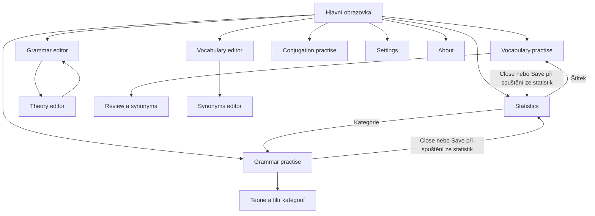

# Navigace GUI

Návrat ze cvičení spuštěného ze statistik zachová jazyk a záložku; data se
znovu načtou. Cvičení spuštěná z hlavní nabídky se vracejí na hlavní obrazovku.

Souvislosti a omezení: [architektura](../ARCHITECTURE.md), [datové smlouvy](../DATA_STORAGE.md), [GUI](../GUI.md).
