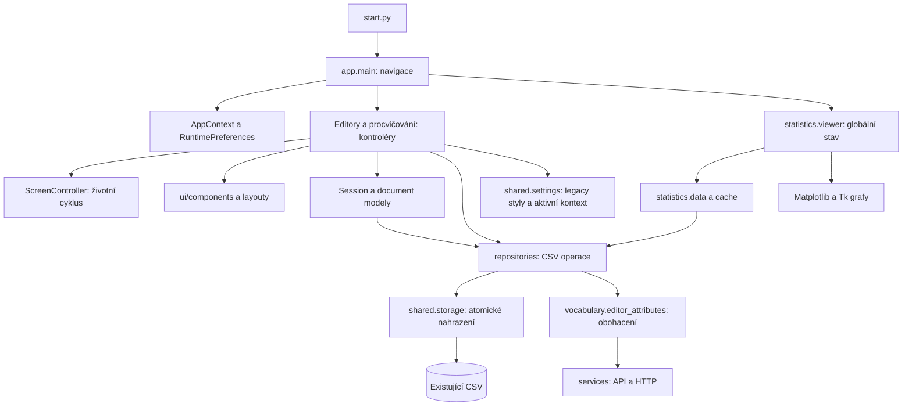
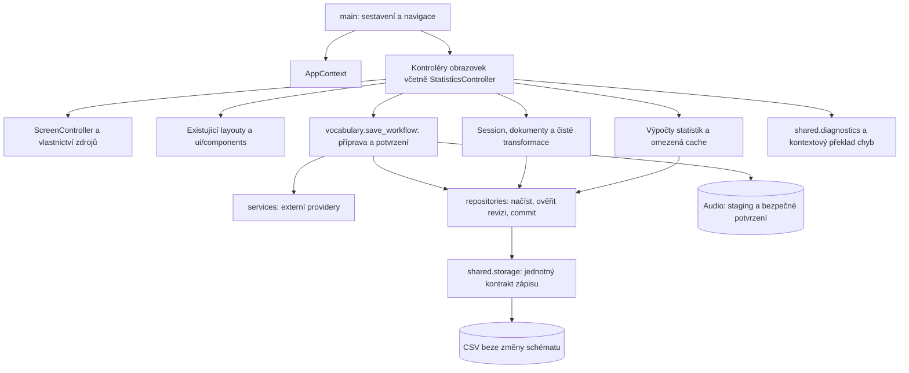

# Architektura před a po refaktoringu

Stav k 15. 11. 2026. První diagram zachycuje historický auditní základ;
druhý odpovídá implementovanému rozdělení odpovědností. Podrobný finální
popis je v [projektové dokumentaci](../project_documentation/ARCHITECTURE.md).

## Původní členění

Silné části zachovat: per-instance kontroléry editorů a tréninků, čisté session
modely, immutable preference snapshot, společné UI prvky a ošetření ukončení
screenů. Document modely zatím kombinují editaci a volání repository; to samo
není důvod ke změně každého modelu na nové vrstvy.

## Implementované členění

Diagram vyjadřuje odpovědnosti, nikoli nový soubor pro každou šipku.
prepare_statistics a StatisticsCache jsou thread-safe příprava dat;
StatisticsController vykresluje po jednotlivých grafech v Tk vlákně.
summary_metrics odstranil opakované sestavování pěti metrik v každé kartě.
ScreenController a AppContext nebyly nahrazeny novým frameworkem.

## Rozhodnutí, přínosy a rizika

| Rozhodnutí | Přínos | Cena / riziko a omezení |
|---|---|---|
| Zachovat funkční API repositories; nezavádět třídu pro každý CSV | Málo abstrakcí, snadné testování | Volající musí předávat revize a změny konzistentně; zajistí kontraktové testy. |
| Orchestrace obohacení do jednoho vocabulary/save_workflow.py | Repository nebude spouštět síť ani řídit celý editorový proces | Přesun musí zachovat progress, cancellation, providers i pořadí commitu. Nejprve regresní scénáře. |
| Stav statistik do jedné instance kontroléru a strukturovaného pohledu | Přestanou se míchat widgety a callbacky různých oken | Zachovat funkci Stats jako vstup; neotvírat nové okno navíc. Převod až po stabilizaci testů. |
| Rozšířit existující bezpečný zápis, nevytvářet obecnou databázovou vrstvu | Jedno místo pro konflikty a chybové stavy | Atomic replace jednoho souboru nezaručuje transakci CSV + audio + synonyma. Neprohlašovat ji za takovou. |
| Sdílet jen malé společné validátory (hlavička, ID, chyba s kontextem) | Stejná diagnostika napříč vstupy | Nepřenést pravidla všech modulů do jedné univerzální funkce s mnoha přepínači. |
| Cache variant podkladů omezit, výpočty oddělit od vykreslení | Kontrolovatelná paměť a odezva | Tk objekty zůstanou ve svém vlákně; nutné testy resize, DPI, hover a zavírání. |
| Zachovat pandas, CustomTkinter, tksheet a Matplotlib | Žádná migrace dat a vzhledu | Doladit verze a styčné body; změnu knihoven audit neopodstatnil. |

## Pravidla mezi vrstvami

- UI nečte CSV ani neskládá cesty řetězcovou konkatenací.
- Session mění paměťový stav; repository provádí I/O, workflow řídí vícekrokovou operaci.
- Žádný pracovní thread nesmí obsluhovat Tk widget. Předává výsledek/progress a
  kontextový snapshot; zrušení před potvrzením nesmí měnit původní soubory.
- Výuková pravidla a výpočty mají být testovatelné bez běžícího okna.
- Nové chyby mají stabilní překladový identifikátor a kontext soubor/řádek/sloupec.
  Technický log nesmí obsahovat URL s API klíčem nebo SMTP heslo.
- AppContext zůstává nositelem cest, konfigurace a navigace. Neplnit ho všemi
  widgety a mutable stavem jednotlivých screenů. Legacy fallback odstraňovat
  postupně, nikoli jen přejmenovat globální stav na service locator.

Veřejné entry pointy, formáty CSV, výuková logika a vizuální vzhled zůstanou.
Jakákoli potřeba měnit tyto smlouvy by znamenala nové schvalované rozhodnutí.
